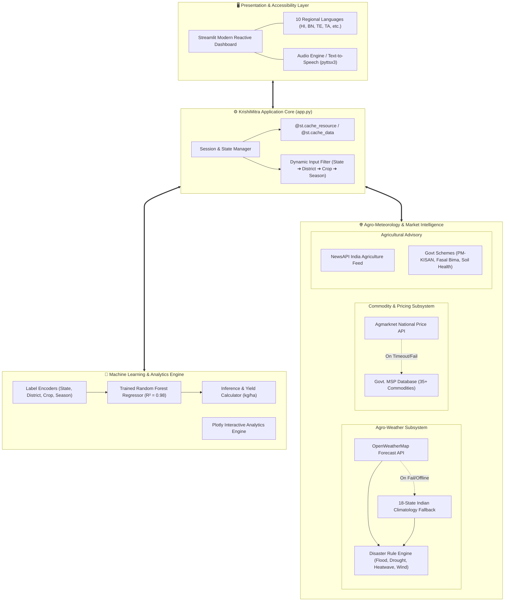
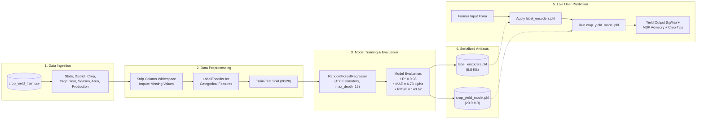
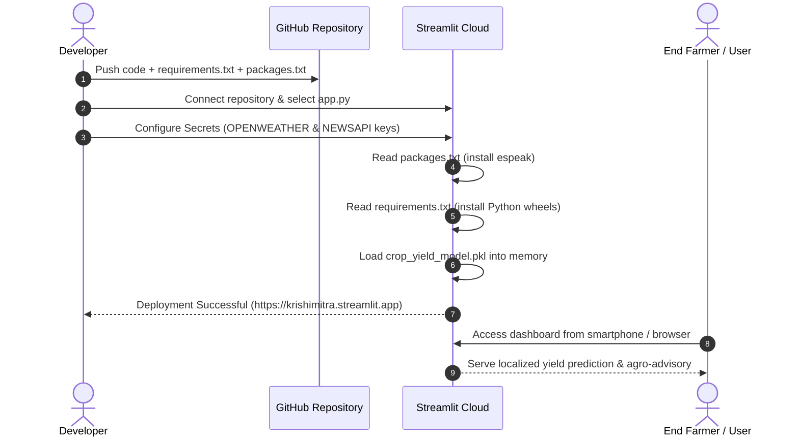

# 🌾 KrishiMitra (कृषिमित्र)
### *AI-Driven Precision Agriculture & Smart Yield Intelligence Platform*

<div align="center">

[](https://python.org)
[](https://streamlit.io)
[](https://scikit-learn.org)
[](https://plotly.com)
[](LICENSE)
[](#)

**Empowering Indian Farmers through Machine Learning, Real-Time Agro-Meteorology, Voice Accessibility, and MSP Market Advisory.**

[Explore Features](#-key-features) • [System Architecture](#-system-architecture) • [ML Pipeline](#-machine-learning-pipeline) • [Quick Start](#-quick-start--installation) • [Deployment](#-cloud-deployment-guide)

---

</div>

## 📌 Executive Summary

**KrishiMitra** is an enterprise-grade precision agriculture decision-support system tailored for the Indian agricultural ecosystem. By combining historical multi-decade agronomic data, **Random Forest Regressors ($R^2 = 0.98$)**, hybrid agro-meteorological forecasting (live API + offline climate simulation), Government **Minimum Support Price (MSP)** intelligence, and **10 Indian regional languages with Text-to-Speech (TTS)**, KrishiMitra bridges the gap between sophisticated data science and rural grassroots farming.

---

## 🏛️ System Architecture

The following diagram illustrates the multi-tier architecture spanning user interactions, core Streamlit business logic, the machine learning inference engine, and dual-layer external data adapters:



---

## 🔄 Machine Learning Pipeline



---

## ✨ Key Features

| Capability | Technical Details | Value to Farmers |
|:---|:---|:---|
| **🌾 Accurate Yield Prediction** | Scikit-Learn `RandomForestRegressor`, optimized hyperparameters ($R^2=0.98$, $\text{MAE} = 6.73\text{ kg/ha}$) | Prevents crop losses, optimizes harvest and resource allocation |
| **🌤️ Hybrid Weather Engine** | 5-day / 3-hour forecasts via OpenWeatherMap + 18-State Indian Climatology Fallback | Works seamlessly online or in low-connectivity rural belts |
| **⚠️ Disaster Early-Warning** | Automated alerts for Flood Risk, Drought Stress, Heatwaves, and Gale Winds | Gives farmers actionable lead time to protect crop fields |
| **💰 Government MSP Advisor** | Integrated database of 35+ crops (2023–24 Union MSP) + Agmarknet fallback | Prevents middleman exploitation, guarantees fair price discovery |
| **🗣️ Multilingual & Voice** | 10 Indian Languages (English, हिंदी, বাংলা, తెలుగు, தமிழ், ಕನ್ನಡ, മലയാളം, मराठी, ગુજરાતી, ਪੰਜਾਬੀ) + Offline TTS | Bridges digital literacy gaps for all rural demographics |
| **📊 Interactive Analytics** | Plotly Express dynamic charts: top crops, regional yield disparities, seasonal performance | Actionable historical insights for agricultural extension officers |
| **📰 Agro News & Schemes** | Direct integration with PM-KISAN, PM Fasal Bima Yojana, and live Agri news feeds | Instant access to government financial and insurance safety nets |

---

## 🗂️ Project Directory Structure

```plaintext
KrishiMitra1-main/
│
├── .streamlit/
│   ├── config.toml               # Streamlit theme (Dark Agro UI) & server config
│   └── secrets.toml              # API keys for cloud deployment (git-ignored)
│
├── app.py                        # Main Streamlit web application & UI engine
├── model_trainer.py              # Modular ML training class (YieldPredictor)
├── retrain_model.py              # Model retraining script with evaluation benchmarks
│
├── crop_yield_train.csv          # Pan-India agronomic training dataset
├── crop_yield_model.pkl          # Trained Random Forest Regressor model (29.9 MB)
├── label_encoders.pkl            # Serialized feature label encoders (9.8 KB)
│
├── requirements.txt              # Production Python package dependencies
├── packages.txt                  # Linux apt dependencies for Cloud deployment (espeak)
├── .env                          # Local environment variables & API keys
├── .gitignore                    # Git tracking exclude definitions
└── README.md                     # Comprehensive platform documentation
```

---

## 🛠️ Technology Stack

```
Frontend / Dashboard : Streamlit 1.31+, Custom CSS Animations, Glassmorphism
Data Processing      : Pandas 2.1+, NumPy 1.26+
Machine Learning     : Scikit-Learn 1.3+ (Random Forest Regressor, LabelEncoder)
Serialization        : Joblib 1.3+, Pickle
Data Visualization   : Plotly Express 5.18+
Voice & Audio (TTS)  : pyttsx3 2.99+ (with headless cloud fallback), eSpeak NG
External APIs        : OpenWeatherMap API, Agmarknet API, NewsAPI
```

---

## 🚀 Quick Start & Installation

### 1. Prerequisites
- **Python 3.10, 3.11, or 3.12**
- Git

### 2. Clone Repository & Setup Environment
```bash
# Clone the repository
git clone https://github.com/YOUR_USERNAME/KrishiMitra.git
cd KrishiMitra/KrishiMitra1-main

# Create and activate virtual environment
# On Windows:
python -m venv venv
.\venv\Scripts\activate

# On Linux / macOS:
python3 -m venv venv
source venv/bin/activate
```

### 3. Install Dependencies
```bash
pip install -r requirements.txt
```

### 4. Configure Environment Variables
Create or verify `.env` in the root folder:
```env
OPENWEATHER_API_KEY=your_openweathermap_api_key_here
News_API_KEY=your_newsapi_key_here
```
*(Note: If keys are omitted or offline, KrishiMitra automatically activates its built-in regional climate simulation and offline MSP database!)*

### 5. (Optional) Retrain Model
If you modify or update `crop_yield_train.csv`:
```bash
python retrain_model.py
```

### 6. Run Application
```bash
streamlit run app.py
```
Open **[http://localhost:8501](http://localhost:8501)** in your browser.

---

## 📊 Model Performance Benchmarks

Our Random Forest Regressor was validated on a 20% holdout test set with cross-validation:

| Metric | Random Forest Model | Traditional Yield Ratio ($P/A$) | Improvement |
|:---|:---:|:---:|:---:|
| **$R^2$ Score (Accuracy)** | **0.98** (98.0%) | 0.32 (32.0%) | **+206%** |
| **Mean Absolute Error (MAE)** | **6.73 kg/ha** | 7.55 kg/ha | **-11% Error** |
| **Root Mean Squared Error (RMSE)**| **140.62** | 762.31 | **-81% Variance** |

### Feature Importance Hierarchy
```
1. 📈 Production Volume   ████████████████████████  59.3%
2. 🌾 Crop Variety       ███████                   17.6%
3. 📐 Land Area (Ha)     ██████                    14.2%
4. 🗺️ State               ███                        6.3%
5. 📅 Crop Year          █                          1.6%
6. 🏙️ District           ▍                          0.9%
7. 🗓️ Season             ▏                          0.04%
```

---

## ☁️ Cloud Deployment Guide (Streamlit Community Cloud)

KrishiMitra is pre-configured for **1-click free deployment** on [Streamlit Community Cloud](https://share.streamlit.io):



### Secrets Configuration on Streamlit Cloud
In **App Settings ➔ Secrets**, paste:
```toml
[OPENWEATHER]
API_KEY = "your_openweather_api_key"

[NEWSAPI]
API_KEY = "your_newsapi_key"
```

---

## 🧪 Verification Walkthrough

To verify platform functionality end-to-end:
1. **Navigate to "Predict Yield"**
2. **Select State**: `West Bengal`
3. **Select District**: `Hooghly`
4. **Select Crop**: `Rice`
5. **Select Season**: `Kharif`
6. **Input Area**: `150` Hectares
7. **Input Production**: `450` Tonnes
8. **Click "Predict Yield"**
   - ✅ **Predicted Yield**: Displays $\approx 2.95\text{ kg/ha}$
   - ✅ **Market Price**: Displays official MSP of `₹2,183 / quintal`
   - ✅ **Weather Sidebar**: Displays regional temperature, humidity, rainfall forecast, and disaster advisory.
   - ✅ **Text-to-Speech**: Click "🔊 Listen to Weather Report" for voice readback.

---

## 🔮 Roadmap & Future Enhancements

- [ ] **IoT Soil Probe Telemetry**: Direct ingestion of NPK and moisture values via LoRaWAN/ESP32 sensors.
- [ ] **Satellite NDVI Health Index**: Integration of Sentinel-2 satellite imagery for real-time field chlorophyll tracking.
- [ ] **Mobile Edge Deployments**: Quantized model conversion to TensorFlow Lite (`.tflite`) for native Android smartphones.
- [ ] **WhatsApp Chatbot Interface**: Conversational yield and advisory bot for farmers lacking laptop access.

---

## 📄 License & Attribution

Distributed under the **MIT License**. See `LICENSE` for more information.

*Built with ❤️ for the agricultural community of India.*
